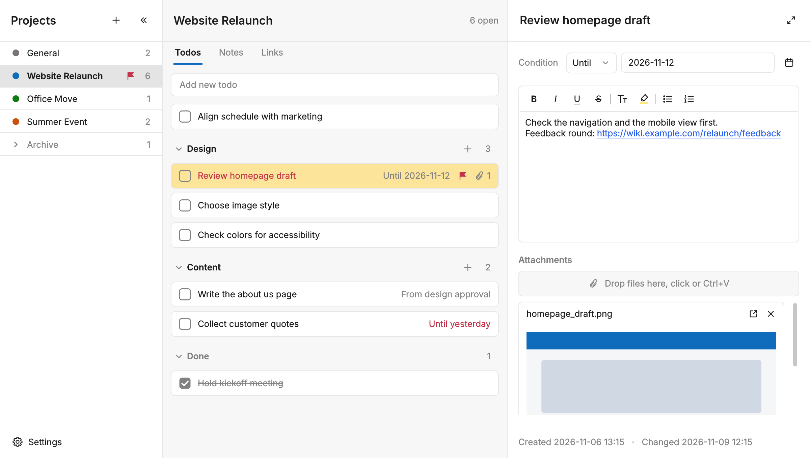

# Project Desk

Project Desk is a Windows app for project-based work. Each project holds its todos, notes and links, with formatted text, images and attachments. Entries, groups and entire projects can be shared with colleagues as `.pdesk` files.

## Installation

1. Download `ProjectDesk_Setup.exe` from the [latest release](https://github.com/giliiiD/ProjectDesk/releases/latest).
2. If Windows blocks the file, right-click it, choose **Properties**, select **Unblock** on the **General** tab and click **OK**.
3. Run the setup. No administrator rights are required. If SmartScreen shows a warning, click **More info** and then **Run anyway**.

New versions install over the existing one. Data and settings are kept.

## User Manual

[Project Desk User Manual (PDF)](docs/ProjectDesk_User_Manual.pdf)

## Development

[DEVELOPMENT.md](DEVELOPMENT.md) is the project documentation: architecture, data format, design rules, testing and the release process. To continue development in a new chat, provide `DEVELOPMENT.md` and `project_desk.py` and start with the section "Quick Start for a New Chat".

Releases are built and published by the GitHub workflow **Release**. For a local build, install Python 3 and Inno Setup and run `build.bat`. The installer is written to `installer\ProjectDesk_Setup.exe`.

---

Version 2.3.1  
Daniel Gilinberg
